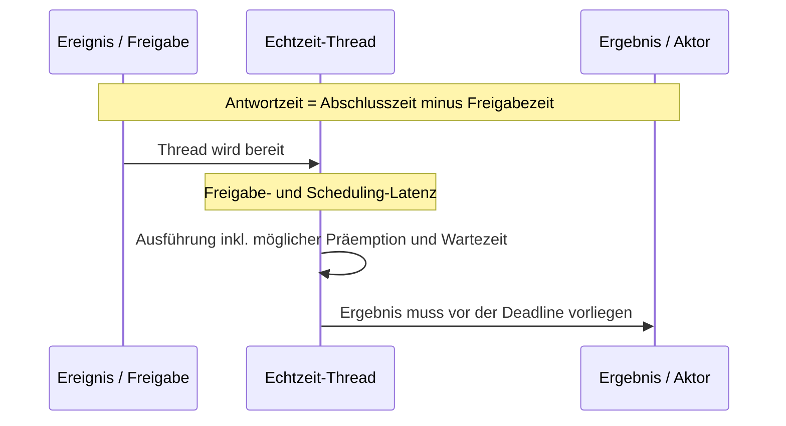

# Exkurs: Echtzeit-Kriterien und Best Practices in Zephyr

**Echtzeit bedeutet nicht „möglichst schnell“, sondern „rechtzeitig und
vorhersagbar“.** Eine schnelle Durchschnittslaufzeit genügt nicht: Entscheidend
ist, ob ein System seine zeitlichen Anforderungen auch unter ungünstiger,
aber spezifizierter Last erfüllt.

## Anforderungen messbar formulieren

Für jede zeitkritische Funktion festlegen, wann sie ausgelöst wird, bis wann
das Ergebnis vorliegen muss und welche Störungen mitzuzählen sind:

| Kriterium | Bedeutung | Beispiel einer Anforderung |
|---|---|---|
| **Deadline** | Spätester zulässiger Abschlusszeitpunkt | „Regelwert liegt spätestens 2 ms nach dem Abtastsignal an.“ |
| **Latenz / Antwortzeit** | Zeit vom Ereignis bis zum Abschluss der Reaktion | ISR-Ereignis bis zur verarbeiteten Nachricht |
| **Jitter** | Schwankung der Start- oder Abschlusszeit zwischen Aktivierungen | Periodischer Task startet höchstens ±100 µs vom Sollzeitpunkt abweichend. |
| **WCET** | Abgesicherte obere Schranke der Ausführungszeit im definierten Betriebsbereich | Task benötigt unter spezifizierter Last höchstens 400 µs CPU-Zeit. |
| **Durchsatz / Periode** | Wie oft Arbeit anfällt bzw. abgeschlossen werden muss | 1.000 Samples/s ohne verlorene Samples. |

Die **Antwortzeit** umfasst mehr als die eigene Ausführungszeit: Freigabe- und
Interruptlatenz, höher priorisierte Arbeit, nicht verdrängbare Abschnitte,
Sperrzeiten und Kontextwechsel können sie verlängern. Klassifiziere außerdem
die Folge einer Deadline-Verletzung: *hart* (unzulässiger Fehler),
*firm* (Ergebnis danach wertlos) oder *soft* (Qualität nimmt ab).

## Best Practices mit Zephyr

- **Prioritäten nach Fristen und Abhängigkeiten entwerfen.** Zephyr wählt
  unter bereiten Threads nach Priorität; kleinere Zahlen bedeuten höhere
  Priorität. Für zeitkritische Arbeit ist präemptives Scheduling meist
  einfacher zu analysieren. Kooperative Threads können die CPU behalten,
  solange sie bereit sind. Time-Slicing teilt CPU-Zeit unter präemptiven
  Threads gleicher Priorität, garantiert aber keine Deadline.
- **Interrupts kurz halten.** ISR: Ereignis quittieren, minimale Daten sichern
  und einen Thread wecken (z. B. Semaphore oder Queue). Keine blockierenden
  Aufrufe und keine umfangreiche Verarbeitung in der ISR. Timer-Expiry-
  Funktionen laufen im Interrupt-Kontext: Arbeit bei Bedarf an einen
  geeigneten Thread delegieren.
- **Wartezeiten und Ressourcen explizit machen.** Mutex nur für kurze,
  begrenzte kritische Abschnitte zwischen Threads einsetzen; Priority
  Inheritance hilft bei Priority Inversion, beseitigt aber weder lange
  Sperrzeiten noch Deadlocks. Endliche Timeouts, Queue-Kapazitäten und
  Überlauf-/Verlustverhalten definieren.
- **Periodische Arbeit driftarm planen.** Eine wiederholte relative Pause nach
  der Verarbeitung verschiebt den nächsten Start um die Bearbeitungszeit.
  Eine feste Zeitbasis bzw. absolute Sollzeitpunkte verwenden und verpasste
  Aktivierungen bewusst behandeln (nachholen, überspringen oder Fehler
  melden).
- **Ressourcen begrenzen.** Stackbedarf inklusive Worst Case dimensionieren,
  Speicher dynamischer Allokation im zeitkritischen Pfad vermeiden und
  Laufzeitkonfiguration, Takt, Energiesparmodi sowie Geräte-/Buslatenzen
  berücksichtigen.
- **Messen und analysieren.** Zeitstempel an Freigabe, Start und Abschluss
  erfassen. `k_cycle_get_32()` eignet sich für kurze hochauflösende
  Intervalle; Zählerüberlauf bei der Auswertung berücksichtigen.
  `k_uptime_get()` liefert Millisekunden-Auflösung. Messungen unter maximaler
  spezifizierter Last, Interruptlast und relevanten Fehlerfällen wiederholen.
  Logging und Debug-Instrumentierung können das Timing verändern.

`CONFIG_SCHED_DEADLINE` und `k_thread_deadline_set()` können bei gleicher
statischer Priorität die Auswahl nach Deadline beeinflussen. Das ersetzt weder
Prioritätsplanung noch WCET-/Antwortzeitanalyse und ist **kein** Nachweis,
dass alle Deadlines eingehalten werden.

## Nachweis statt Bauchgefühl

Eine Messung des beobachteten Maximums ist keine garantierte WCET. Ergänze
Messungen durch Analyse der längsten Pfade und des schlimmsten spezifizierten
Interferenzfalls. Prüfe Worst-Case-Last auf dem echten Zielsystem; Simulation
und `native_sim` helfen bei Funktion und Scheduling-Logik, belegen aber nicht
automatisch das Hardware-Timing. Akzeptanzkriterien müssen prüfbar sein:
Deadline-Fehler zählen, maximale Latenz/Jitter protokollieren und Grenzwerte
im Test explizit bewerten.

**Merksatz:** Anforderungen quantifizieren, Ausführungs- und Blockierzeiten
begrenzen, unter Worst-Case-Bedingungen messen und analysieren. Ein RTOS
unterstützt Echtzeitverhalten – die Garantie entsteht erst durch das
Gesamtdesign und dessen Nachweis.

Weiterführend: [Scheduling-Modelle](scheduling-modelle.md),
[Priority Inversion](priority-inversion.md),
[Synchronisierungsmechanismen](synchronisierung.md) und
[Threading debuggen](threading-debugging.md).
