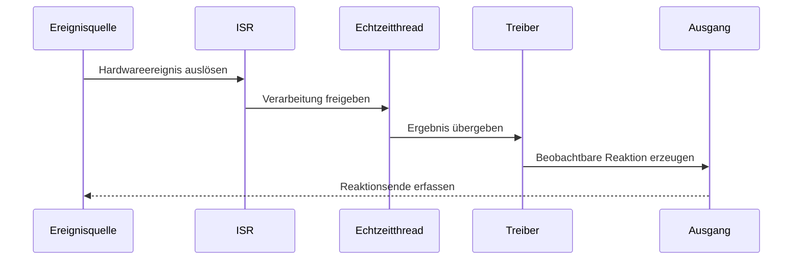
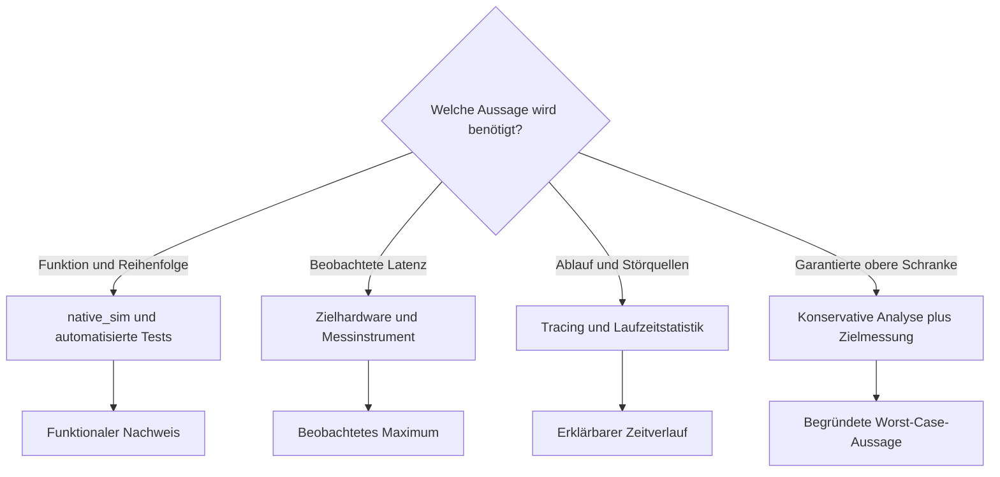

# Exkurs: Echtzeitverhalten belastbar nachweisen

Echtzeitfähigkeit bedeutet nicht, dass ein System im Mittel schnell reagiert. Entscheidend ist,
dass eine geforderte Reaktion innerhalb einer festgelegten Zeitgrenze erfolgt. Ein belastbarer
Nachweis verbindet deshalb drei Perspektiven:

1. ein präzises Zeitverhalten als Anforderung,
2. eine analytische Begründung der oberen Schranken und
3. Messungen auf der tatsächlichen Zielhardware unter repräsentativer Maximallast.

Ein einzelner schneller Messwert, ein Mittelwert oder ein erfolgreicher Lauf auf `native_sim`
reicht dafür nicht aus. Messungen zeigen, was beobachtet wurde; sie beweisen für sich allein nicht,
dass nie ein längerer Ablauf auftreten kann.

## Was soll nachgewiesen werden?

Jeder Nachweis beginnt mit einem überprüfbaren Zeitvertrag. Aussagen wie „reagiert schnell“ oder
„ist echtzeitfähig“ sind nicht messbar. Stattdessen werden mindestens diese Größen festgelegt:

| Größe | Leitfrage | Beispiel |
|---|---|---|
| Auslöser | Welches Ereignis startet die Zeitmessung? | fallende GPIO-Flanke |
| Reaktion | Welches beobachtbare Ereignis beendet sie? | Ausgang wird gesetzt |
| Deadline `D` | Bis wann muss die Reaktion abgeschlossen sein? | spätestens nach 250 µs |
| Periode `T` | Wie oft tritt das Ereignis regulär auf? | alle 2 ms |
| minimale Zwischenankunftszeit | Wie dicht dürfen sporadische Ereignisse aufeinanderfolgen? | mindestens 500 µs |
| Ausführungszeit `C` | Wie viel CPU-Zeit benötigt ein Verarbeitungsschritt? | höchstens 40 µs |
| Antwortzeit `R` | Wie lange dauert es vom Auslöser bis zum Abschluss? | höchstens 180 µs |
| Jitter | Wie stark darf ein Zeitpunkt oder eine Dauer schwanken? | maximal 15 µs |
| Betriebsbereich | Unter welchen Last-, Takt-, Temperatur- und Energiesparbedingungen gilt die Aussage? | Funk, Flash und DMA gleichzeitig aktiv |
| Fehlertoleranz | Sind Deadline-Verletzungen zulässig? | keine Verletzung im definierten Betriebsbereich |

Die grundlegende Bedingung lautet:

```text
R_max <= D
Zeitreserve = D - R_max
```

`R_max` muss zu der Art des Nachweises passen. Ein beobachtetes Maximum ist noch keine garantierte
obere Schranke. Im Bericht sollte es deshalb ausdrücklich als `R_max,beobachtet` bezeichnet werden.

## Harte, feste und weiche Echtzeit

| Klasse | Bedeutung einer Deadline-Verletzung | Geeignete Nachweisstärke |
|---|---|---|
| Harte Echtzeit | Eine Verletzung ist im spezifizierten Betriebsbereich unzulässig. | konservative Analyse plus Messungen und Stresstests |
| Feste Echtzeit | Ein verspätetes Ergebnis ist wertlos, einzelne Verletzungen können jedoch toleriert werden. | quantifizierte Fehlerrate, Messstatistik und Grenzlasttests |
| Weiche Echtzeit | Verspätungen verschlechtern die Qualität, bleiben aber funktional beherrschbar. | Verteilung, Quantile, beobachtetes Maximum und Qualitätsziel |

Bei harter Echtzeit ist „in einer Million Messungen nicht verletzt“ kein vollständiger Beweis. Es
ist ein starkes Testergebnis, aber keine mathematische Aussage über alle möglichen Abläufe.

## Nachweisstrategie

```mermaid
flowchart LR
    requirement["Zeitvertrag festlegen"] --> pathModel["Ausführungspfad und Ressourcen modellieren"]
    pathModel --> analysis["WCET, Blocking und Interferenz analysieren"]
    analysis --> instrumentation["Messpunkte und Messfehler festlegen"]
    instrumentation --> targetRun["Auf Zielhardware unter Grenzlast messen"]
    targetRun --> evaluation["Deadline, Jitter und Reserve bewerten"]
    evaluation --> evidence["Nachweisdossier versionieren"]
```



Die Schritte ergänzen sich. Eine Analyse kann übersehene Hardwareeffekte enthalten; eine Messung
kann seltene Pfade verfehlen. Stimmen beide Perspektiven überein und bleibt eine ausreichende
Reserve, wird die Aussage wesentlich belastbarer.

### 1. Den vollständigen Reaktionspfad abgrenzen

Die Messgrenze muss den fachlich relevanten Pfad umfassen. Für eine externe Reaktion kann er so
aussehen:



Eine reine Messung innerhalb des Threads lässt Interruptlatenz, Scheduling, Treiber und Hardware
außerhalb der Messgrenze. Sie kann zur Ursachenanalyse nützlich sein, ist aber kein
Ende-zu-Ende-Nachweis.

### 2. Analytische Schranken bestimmen

Für jeden echtzeitkritischen Thread oder Job werden mindestens folgende Beiträge erfasst:

- konservative Ausführungszeit des eigenen Pfads,
- Unterbrechungen durch höher priorisierte Threads und ISRs,
- Blocking durch Mutex, Treiber, Busse und kritische Abschnitte,
- deaktivierte Interrupts und Scheduler-Sperren,
- gemeinsam genutzte Hardware wie Flash, Cache, DMA und Speicherbus,
- Aufwachzeiten aus Energiezuständen,
- Laufzeit von Protokollstacks und Bibliotheken auf dem kritischen Pfad.

Für ein einfaches System mit festen Prioritäten kann die Worst-Case-Antwortzeit eines Threads `i`
iterativ abgeschätzt werden:

```text
R_i^(0)   = C_i + B_i
R_i^(n+1) = C_i + B_i + Summe über j in hp(i): ceil(R_i^(n) / T_j) * C_j
```

Dabei sind:

- `C_i`: konservative Ausführungszeit des betrachteten Threads,
- `B_i`: maximale Blocking-Zeit durch niedriger priorisierte Ausführung,
- `hp(i)`: höher priorisierte Threads, die den Thread verdrängen können,
- `C_j`: Ausführungszeit eines höher priorisierten Threads,
- `T_j`: Periode oder minimale Zwischenankunftszeit dieses Threads.

Die Iteration endet, wenn sich `R_i` nicht mehr ändert oder `R_i > D_i` wird. ISR-Kosten müssen
zusätzlich berücksichtigt werden, wenn sie nicht bereits in `C` oder in einer eigenen
Interferenzsumme enthalten sind. Die Formel ist ein Modell, kein universeller Beweis: SMP,
Cacheeffekte, DMA, komplexe Abhängigkeiten oder selbstsuspendierende Tasks erfordern ein
erweitertes Verfahren.

Die grobe CPU-Auslastung

```text
U = Summe(C_i / T_i)
```

ist ein Plausibilitätswert. `U < 1` ist allein kein Scheduling-Nachweis, weil Prioritäten,
Blocking, Deadlines und Ankunftsmuster unberücksichtigt bleiben.

### 3. Auf der Zielhardware messen

Die stärkste praktische Messung erfasst den fachlichen Pfad an seinen physikalischen Grenzen:

- Eingangssignal oder Test-Pin erzeugt den Auslöser,
- die Anwendung setzt am Reaktionsende einen zweiten GPIO,
- Oszilloskop oder Logikanalysator misst die Differenz,
- die Messung läuft mit repräsentativer Last über ausreichend viele Ereignisse,
- Rohdaten, Histogramm, Maximum und Testkonfiguration werden archiviert.

Damit werden auch Interruptcontroller, ISR, Scheduler, Treiber und GPIO-Hardware erfasst. Vor der
Auswertung sind Auflösung, Triggerunsicherheit, Kabel- und Geräteverzögerung sowie die
Instrumentierungszeit zu bestimmen. Eine Loopback-Messung kann den Messaufbau kalibrieren.

### 4. Grenzlast gezielt herstellen

„Normalbetrieb“ ist für einen Worst-Case-Nachweis zu schwach. Relevante Kombinationen werden
systematisch variiert:

| Einfluss | Zu prüfende Grenzsituation |
|---|---|
| Interrupts | höchste zulässige Interruptfrequenz und konkurrierende IRQs |
| Threads | alle höher priorisierten Threads gleichzeitig aktiv |
| Synchronisation | längster erlaubter kritischer Abschnitt und belegte Mutexe |
| Kommunikation | maximale Paket-, Bus- und Queue-Last |
| Speicher | Flashzugriffe, Cache kalt und warm, DMA und Buskonkurrenz |
| Energieverwaltung | tiefster erlaubter Zustand und maximale Aufwachlatenz |
| Takt | kleinste im Betrieb zulässige CPU- und Busfrequenz |
| Diagnose | produktive Logging- und Tracing-Konfiguration |
| Eingaben | längster gültiger Verarbeitungspfad und Burst-Ankünfte |
| Laufzeit | Langzeittest für seltene Phasenkopplungen und Überläufe |

Testlasten müssen gültige Betriebsbedingungen darstellen. Ein künstlicher Fall außerhalb der
Spezifikation widerlegt den Nachweis nicht, kann aber robuste Reserven sichtbar machen.

## Welche Methode beantwortet welche Frage?



| Verfahren | Stärken | Grenzen |
|---|---|---|
| Statische WCET- und Antwortzeitanalyse | kann konservative obere Schranken begründen | Modellqualität und Hardwaremodell sind entscheidend |
| GPIO plus Oszilloskop oder Logikanalysator | geringe Rückwirkung und echte Ende-zu-Ende-Sicht | beobachtet nur ausgeführte Fälle; interne Ursache nicht immer sichtbar |
| Zephyr Timing API | einfache Messung kleiner Codebereiche in Zyklen und Nanosekunden | Instrumentierungsaufwand; kein vollständiger Systempfad |
| Tracing | zeigt ISR-, Thread-, Syscall- und Zustandsabfolgen | Tracepuffer und Transport können Verhalten beeinflussen |
| Thread Analyzer und Runtime Stats | zeigt CPU-Anteile, Stacknutzung und lange Frames | grobe Diagnose; kein Deadline-Nachweis |
| Kernel-Latenzbenchmark | vergleicht Kerneloperationen und Konfigurationen | Mittelwerte einzelner Primitive ersetzen keinen Anwendungsnachweis |
| Langzeit- und Stresstest | findet seltene Interferenzen und Regressionen | endliche Testdauer deckt nicht alle möglichen Abläufe ab |
| `native_sim` | schnell, reproduzierbar und gut für Funktions- und Ablaufprüfungen | bildet MCU-Ausführungszeiten und reale Hardwarelatenzen nicht nach |

## Zephyr-Werkzeuge praktisch einsetzen

### Timing API für einen Codeabschnitt

In `prj.conf`:

```ini
CONFIG_TIMING_FUNCTIONS=y
```

Minimaler Messrahmen:

```c
#include <inttypes.h>
#include <stdint.h>
#include <zephyr/kernel.h>
#include <zephyr/sys/printk.h>
#include <zephyr/timing/timing.h>

extern void critical_path(void);

static uint64_t measure_critical_path_ns(void)
{
    timing_t start;
    timing_t stop;
    uint64_t cycles;

    timing_init();
    timing_start();

    start = timing_counter_get();
    critical_path();
    stop = timing_counter_get();

    cycles = timing_cycles_get(&start, &stop);
    timing_stop();

    return timing_cycles_to_ns(cycles);
}
```

Für belastbare Werte darf die Ausgabe nicht in der gemessenen Region liegen. Zusätzlich wird der
Overhead einer leeren Messung ermittelt. Warm-up-Läufe, Compileroptimierung, Caches und mögliche
Überläufe des Zählers sind zu dokumentieren. Einzelwerte sollten nicht laufend synchron geloggt,
sondern in einem Puffer gesammelt und nach der Messphase ausgegeben werden.

### Kernel-Latenzbenchmark

Zephyr enthält unter `zephyr/tests/benchmarks/latency_measure` einen Benchmark für unter anderem
Kontextwechsel, ISR-Rückkehr, Semaphore, Mutex und Queues. Er eignet sich als Referenz- und
Regressionsmessung für eine konkrete Buildkonfiguration:

```sh
west build -p always -b nrf52840dongle \
  zephyr/tests/benchmarks/latency_measure \
  -d build/latency-nrf52840dongle
west flash -d build/latency-nrf52840dongle
west build -d build/latency-nrf52840dongle -t run
```

Abhängig vom Runner erfolgt die Ausgabe über die konfigurierte Konsole; `-t run` ist nicht bei
jeder Hardware verfügbar. Für das ESP32-C5-DevKitC-1 wird entsprechend gebaut:

```sh
west build -p always -b esp32c5_devkitc \
  zephyr/tests/benchmarks/latency_measure \
  -d build/latency-esp32c5-devkitc
```

Die ausgegebenen Durchschnittswerte beschreiben Kernelprimitive. Sie sind keine WCET des eigenen
Anwendungspfads. Aussagekräftig wird der Vergleich nur bei identischer Hardware, Taktung,
Zephyr-Version, Toolchain, Optimierung und Kconfig-Konfiguration.

### Thread Analyzer und Laufzeitstatistik

Für einen Diagnosebuild können diese Optionen aktiviert werden:

```ini
CONFIG_THREAD_ANALYZER=y
CONFIG_THREAD_ANALYZER_USE_PRINTK=y
CONFIG_THREAD_ANALYZER_AUTO=y
CONFIG_THREAD_ANALYZER_AUTO_INTERVAL=5
CONFIG_THREAD_NAME=y
```

Der Thread Analyzer zeigt unter anderem Stacknutzung und Thread-Laufzeitanteile. Er hilft,
unerwartete CPU-Verbraucher und zu kleine Stacks zu finden. Prozentuale CPU-Auslastung ist jedoch
keine Aussage darüber, ob jede einzelne Deadline eingehalten wurde. Auch der Analyzer selbst
verbraucht Laufzeit; der finale Nachweis muss die produktive Konfiguration berücksichtigen.

### Tracing

Zephyrs Tracing kann Threadwechsel, ISRs, Systemaufrufe und eigene Ereignisse sichtbar machen.
Backends wie SEGGER SystemView oder Percepio helfen, folgende Fragen zu beantworten:

- Welcher Thread hat den kritischen Thread verdrängt?
- Wie lange war ein Interrupt oder der Scheduler gesperrt?
- Wo entstand eine Prioritätsinversion?
- War ein langer Pfad CPU-Zeit, Blocking oder I/O-Wartezeit?

Tracing ist besonders wertvoll, um Ausreißer zu erklären. Je nach Transport und Pufferung kann es
das System beeinflussen. Deshalb werden Messungen mit und ohne Tracing verglichen und die
produktive Buildkonfiguration separat geprüft.

## Rolle von `native_sim`

`native_sim` bleibt für die Vorbereitung sehr nützlich:

- funktionale Pfade und Synchronisation prüfen,
- Aktivierungsfolgen reproduzierbar ausführen,
- Messwertsammlung und Histogrammlogik entwickeln,
- Überlast- und Timeoutverhalten auf fachlicher Ebene testen,
- Testfälle schnell in Automatisierung ausführen.

Es liefert aber keinen belastbaren Zeitnachweis für nRF52840 Dongle oder ESP32-C5-DevKitC-1. Der
Zephyr-Code läuft als Hostprozess; CPU, Interruptcontroller, Cache, Flash, Busse, Peripherie und
Energiezustände der Zielhardware werden nicht zeitgetreu nachgebildet. Selbst wenn simulierte Zeit
und Hostzeit ähnlich fortschreiten, folgt daraus keine MCU-WCET oder Interruptlatenz.

Die Arbeitsteilung lautet daher:

| Ziel | Geeignete Umgebung |
|---|---|
| Funktion, Ablauf und Datenerfassung entwickeln | `native_sim` |
| Instrumentierung und Buildkonfiguration prüfen | `native_sim`, anschließend Zielhardware |
| reale Latenz, Jitter und Aufwachzeit messen | nRF52840 Dongle oder ESP32-C5-DevKitC-1 |
| harte obere Schranke begründen | analytisches Modell plus Messungen auf Zielhardware |

## Auswertung von Messreihen

Mindestens folgende Kennzahlen sollten getrennt ausgewiesen werden:

- Anzahl der gültigen und verworfenen Messungen,
- Minimum, Median und arithmetischer Mittelwert,
- hohe Quantile wie P99 und P99,9 bei weicher oder fester Echtzeit,
- beobachtetes Maximum,
- Anzahl und Anteil der Deadline-Verletzungen,
- kleinste beobachtete Zeitreserve,
- Histogramm mit sinnvoller Klassenbreite,
- Testdauer und Anzahl der Lastzyklen.

Quantile dürfen das Maximum bei harter Echtzeit nicht ersetzen. Ein P99,9-Wert bedeutet, dass
0,1 Prozent der beobachteten Werte darüber lagen oder liegen können. Auch das beobachtete Maximum
bleibt von Testumfang und Testverteilung abhängig.

Ausreißer werden nicht ohne technische Begründung entfernt. Warm-up, Messgerätefehler oder bewusst
ausgeschlossene Betriebszustände müssen vorab definiert und im Bericht sichtbar bleiben.

## Typische Fehlschlüsse

- „Der Mittelwert liegt unter der Deadline“ ignoriert Ausreißer.
- „Die CPU ist nur zu 40 Prozent ausgelastet“ ignoriert Prioritäten und Blocking.
- „Eine Million Läufe waren erfolgreich“ beweist keine unendliche Fehlerfreiheit.
- „Der Code ist auf `native_sim` schnell“ sagt nichts über die MCU-Laufzeit aus.
- „Die Funktion braucht 20 µs“ ignoriert Interrupt- und Schedulinglatenz außerhalb der Funktion.
- „Tracing zeigt keinen Fehler“ kann durch begrenzte Puffer oder Messrückwirkung täuschen.
- „Mehr Priorität löst das Problem“ kann lediglich die Deadline eines anderen Threads verletzen.
- „Ohne Logging ist es schneller“ ist nur relevant, wenn genau diese Konfiguration ausgeliefert wird.

## Inhalt eines Nachweisdossiers

Ein reproduzierbarer Nachweis hält nicht nur das Endergebnis fest, sondern auch dessen Gültigkeitsbereich:

1. eindeutige Anforderungs-ID und Zeitvertrag,
2. Diagramm des vollständigen Reaktionspfads,
3. Schedulingmodell mit Threads, ISRs, Prioritäten, Perioden und Deadlines,
4. WCET-, Blocking- und Interferenzannahmen samt Herleitung,
5. Hardwarestand, Taktung, Energiezustände und Peripheriekonfiguration,
6. Zephyr-Commit oder Version, Toolchain und Compileroptionen,
7. vollständige `.config`, Devicetree-Ausgabe und Firmware-Hash,
8. Messpunkte, Geräte, Auflösung und Kalibrierung,
9. Lastprofile, Eingabedaten, Laufdauer und Wiederholungszahl,
10. Rohmesswerte, Auswerteskript, Histogramme und Ausreißeranalyse,
11. beobachtetes Maximum, analytische Schranke und verbleibende Zeitreserve,
12. bekannte Grenzen und Bedingungen für eine erneute Prüfung.

Eine Änderung an Prioritäten, Takt, Kconfig, Compiler, Treibern, Logging, Power Management oder
Hardware kann den Gültigkeitsbereich verlassen. Solche Änderungen müssen deshalb eine gezielte
Neubewertung oder Wiederholungsmessung auslösen.

## Empfohlener Ablauf im Training

1. Auf `native_sim` den fachlichen Auslöser und das Reaktionsende eindeutig markieren.
2. Thread-, ISR- und Ressourcenmodell erstellen.
3. Timing-Erfassung und statistische Auswertung funktional testen.
4. Dieselbe Anwendung für nRF52840 Dongle oder ESP32-C5-DevKitC-1 bauen.
5. Ende-zu-Ende-Latenz über GPIO und Messgerät erfassen.
6. Grenzlasten einzeln und kombiniert zuschalten.
7. einen auffälligen Lauf mit Tracing erklären.
8. Analyse, Messmaximum und Deadline gegenüberstellen.
9. Konfiguration, Artefakte und Rohdaten gemeinsam versionieren.

Der wichtigste Satz für die Praxis lautet: `native_sim` bereitet den Nachweis vor; erbracht wird
der hardwarespezifische Zeitnachweis auf der tatsächlichen Zielplattform.
