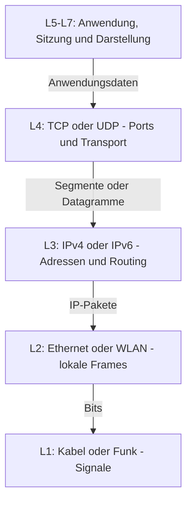
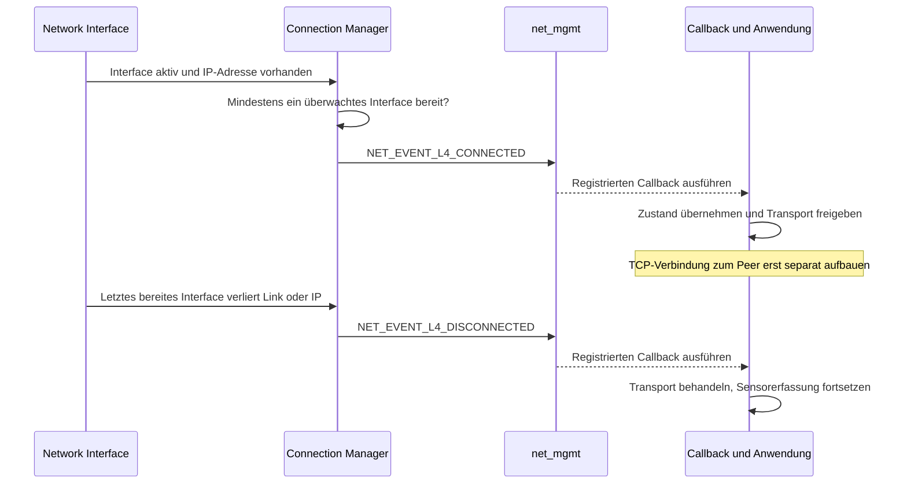

# Exkurs: Network Management und Connection Manager

Zephyr verteilt Netzwerkereignisse über **Network Management (`net_mgmt`)**.
Der **Connection Manager** bewertet die IP-Konnektivität über mehrere Interfaces hinweg.
Damit reagiert die Anwendung auf einen gemeinsamen Zustand, unabhängig von Ethernet,
WLAN oder einer anderen unterstützten Netzwerktechnik.

## L1 bis L7: Einordnung im OSI-Modell

**L steht für Layer, also Schicht.** Jede Schicht bietet der darüberliegenden einen
Dienst. Das OSI-Modell hilft, Netzwerkaufgaben und Fehler zuzuordnen; ein TCP/IP-Stack
bildet nicht jede Schicht als eigenes Softwaremodul ab.

| Layer | Name | Aufgabe und Beispiel |
|---|---|---|
| **L1** | Bitübertragung / Physical | Signale und Bits auf dem Medium: Kabel, Funk, PHY. |
| **L2** | Sicherung / Data Link | Frames im lokalen Netz, Medienzugriff und Link-Adressen: Ethernet-MAC, WLAN. |
| **L3** | Vermittlung / Network | Logische Adressen und Weiterleitung zwischen Netzen: IPv4/IPv6 und Routing. |
| **L4** | Transport | Kommunikation zwischen Endpunkten über Ports: TCP als zuverlässiger Bytestrom, UDP als Datagramme ohne Liefergarantie. |
| **L5** | Sitzung / Session | Dialoge organisieren, fortsetzen und synchronisieren. |
| **L6** | Darstellung / Presentation | Datenrepräsentation und Umwandlung: Kodierung, Serialisierung, ggf. Verschlüsselung. |
| **L7** | Anwendung / Application | Bedeutung des Protokolls: HTTP, MQTT oder die Statusabfrage `GET` im Kurs. |

Im TCP/IP-Modell sind die Funktionen von L5–L7 meist in der Anwendungsschicht
zusammengefasst. Eine TCP-Verbindung gehört zu L4; das fachliche Request-/Antwortformat
liegt darüber. Diese Einordnung ist ein Modell, keine feste Zuordnung jeder Bibliothek.
[OSI-Referenzmodell: ITU-T X.200](https://www.itu.int/rec/T-REC-X.200-199407-I/en)



Beim Senden werden Daten schrittweise gekapselt, beim Empfangen in umgekehrter Richtung
entpackt. **Loopback im Kurs** transportiert die Pakete intern und benötigt kein reales
Kabel, Funkmedium oder externes Ethernet-Netz.

## Wer übernimmt welche Aufgabe?

| Baustein | Aufgabe | Typische Schnittstelle |
|---|---|---|
| **Network Interface** | Einzelne Schnittstelle, Betriebszustand und IP-Adressen | `net_if` |
| **Network Management** | Management-Anfragen und Ereignisse verteilen | `net_mgmt_add_event_callback()` |
| **Connection Manager** | Konnektivität überwachen; mit passender Implementierung Verbindungen steuern | `conn_mgr_mon_resend_status()` |
| **Anwendung / Transport** | Fachzustand pflegen, TCP-Anfragen und Fehler behandeln | `app_state`, Socket-API |

**Ereignisweg:** Interface-Zustand → Connection Manager → `net_mgmt` → Callback → Anwendung.
[Dokumentation: Network Management](https://docs.zephyrproject.org/latest/services/connectivity/networking/api/net_mgmt.html)

## Was bedeutet „connected“?

Ein überwachtes Interface gilt als bereit, wenn es administrativ und operativ aktiv ist,
eine IP-Adresse besitzt und nicht ignoriert wird. Mindestens ein bereites Interface löst
`NET_EVENT_L4_CONNECTED` aus; fällt das letzte aus, folgt `NET_EVENT_L4_DISCONNECTED`.
Diese Events beschreiben den **Gesamtzustand**. Zephyrs Bezeichnung `L4_CONNECTED`
meldet hier die Bereitschaft für IP-Kommunikation auf Grundlage von Interface- und
Adresszustand. **Sie bedeutet nicht, dass bereits eine TCP-Verbindung besteht.**
Das Event garantiert weder eine passende Route zum Ziel noch Internetzugang oder die
Erreichbarkeit eines bestimmten Servers. TCP-Handshake und Socketfehler sind separat
zu behandeln; bei UDP gibt es keinen TCP-artigen Verbindungsaufbau.

Nach der Callback-Registrierung fordert `conn_mgr_mon_resend_status()` den aktuellen
Status erneut als Event an. So erreicht die Anwendung auch ein bereits verbundenes Netz.
Der Aufruf liefert keinen synchronen Zustandswert.
[Dokumentation: Connection Manager](https://docs.zephyrproject.org/latest/services/connectivity/networking/conn_mgr/main.html)

### Vom Interface zum Anwendungszustand



Das Diagramm zeigt den Übergang von keinem zu mindestens einem bereiten Interface und
zurück. Fällt nur eines von mehreren bereiten Interfaces aus, bleibt der Gesamtzustand
verbunden. `net_mgmt` transportiert Managementereignisse; die TCP-Nutzdaten nehmen den
Weg durch den Netzwerkstack, nicht durch diesen Callback.

**Diagnose von unten nach oben:** L1/L2: Link verfügbar? L3: Adresse und Route passend?
L4: Zielport erreichbar, Timeout oder Peer-Close? L7: Request vollständig und gültig,
Antwort fachlich korrekt? Im Loopback-Aufbau entfällt die Prüfung eines physischen Links.

## Minimaler Listener für den aktuellen Zustand

Für das Monitoring: `CONFIG_NETWORKING=y`, `CONFIG_NET_MGMT=y`,
`CONFIG_NET_MGMT_EVENT=y`, `CONFIG_NET_CONNECTION_MANAGER=y`; Interface und IP-Konfiguration
kommen hinzu. Die Callback-Signatur entspricht der Kursversion Zephyr 4.4.2.

```c
#include <stdint.h>
#include <zephyr/kernel.h>
#include <zephyr/sys/atomic.h>
#include <zephyr/net/net_mgmt.h>
#include <zephyr/net/conn_mgr_monitor.h>

static struct net_mgmt_event_callback callback;
static atomic_t connected; /* Bis zum ersten Event vorsichtig als offline behandeln. */
K_SEM_DEFINE(state_changed, 0, 1);

static void on_l4(struct net_mgmt_event_callback *cb,
                  uint64_t event, struct net_if *iface)
{
    ARG_UNUSED(cb);
    ARG_UNUSED(iface);
    if (event != NET_EVENT_L4_CONNECTED &&
        event != NET_EVENT_L4_DISCONNECTED) { return; }
    atomic_set(&connected, event == NET_EVENT_L4_CONNECTED);
    k_sem_give(&state_changed);
}

void network_monitor_start(void) /* Einmal beim Anwendungsstart aufrufen. */
{
    net_mgmt_init_event_callback(&callback, on_l4,
        NET_EVENT_L4_CONNECTED | NET_EVENT_L4_DISCONNECTED);
    net_mgmt_add_event_callback(&callback);
    conn_mgr_mon_resend_status();
}
```

Ein Anwendungsthread wartet auf `state_changed` und liest `atomic_get(&connected)`.
Der Callback filtert die exakten Events und meldet nur den Zustand; längere Arbeit und
Socketzugriffe gehören in den Anwendungsthread.

## Regeln für das Tagesprojekt

- **Zustand und Ereignis unterscheiden:** Das Beispiel fasst schnelle Änderungen zusammen.
  Müssen alle Transitionen gezählt werden, Events in einer Queue mit Überlaufpolicy sichern.
- **Verarbeitung abwarten:** Netzwerkevents können asynchron eintreffen. Auf eine Bestätigung
  der Zustandsübernahme warten; `k_work_flush()` allein bestätigt keinen Netzwerk-Callback.
- **Offline weiter erfassen:** Sensor-Pipeline weiterlaufen lassen, Transport passend sperren
  und bei Wiederverbindung einen aktuellen Snapshot anbieten. Socketfehler separat behandeln.
- **Lehrstimuli einordnen:** Manuell ausgelöste L4-Events prüfen den Anwendungspfad;
  sie stellen keine reale Verbindung her.

**Merksatz:** Der Connection Manager bewertet Konnektivität, `net_mgmt` meldet Ereignisse,
die Anwendung entscheidet über ihre Reaktion.

Kursbezug: [4.09 – Event-Walkthrough](../practices/day4/4.09-network-management-walkthrough/README.md)
und [4.10 – Anwendungszustand](../practices/day4/4.10-connectivity-state/README.md).
