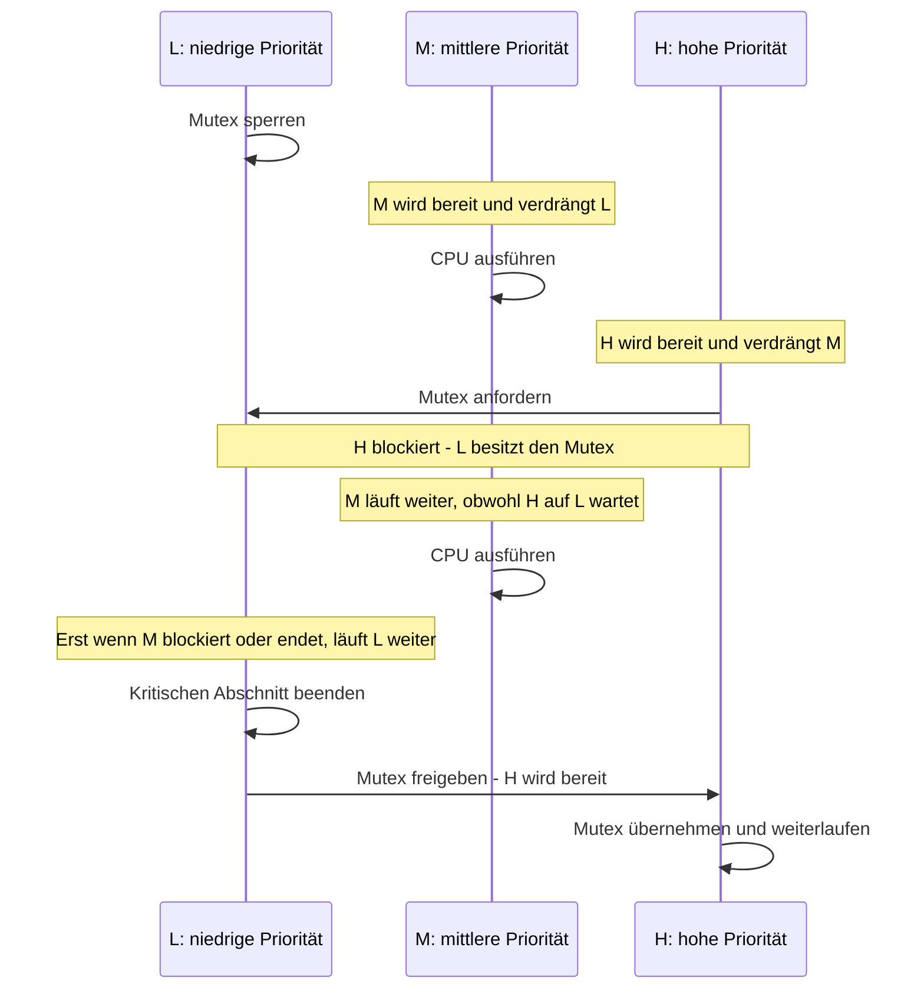
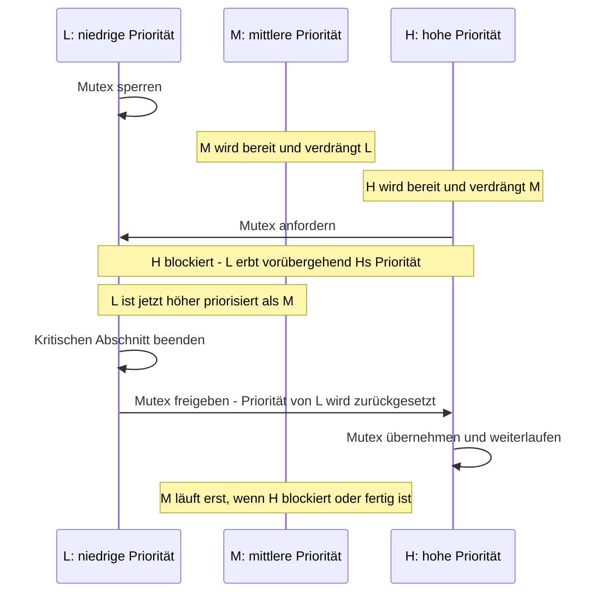

# Exkurs: Priority Inversion

**Priority inversion** (Prioritätsumkehr) tritt auf, wenn ein Thread mit hoher
Priorität indirekt von einem Thread mit niedriger Priorität aufgehalten wird.
Besonders kritisch ist das in Echtzeitsystemen: Die höher priorisierte Arbeit
kann ihre Deadline verpassen, obwohl sie selbst kaum CPU-Zeit benötigt.

## Wie entsteht die Umkehr?

Es gibt drei Threads: **L** (niedrige), **M** (mittlere) und **H** (hohe
Priorität). Kleinere Prioritätszahlen bedeuten in Zephyr eine höhere
Priorität. L hält einen Mutex. M verdrängt L, dann wird H bereit und verdrängt
M. H will denselben Mutex, muss aber warten. Weil H blockiert ist, läuft M
weiter und hält so indirekt L davon ab, den Mutex freizugeben:

Das Problem ist nicht bloß, dass H auf L warten muss: Diese Wartezeit ist
notwendig, solange L den Mutex besitzt. Die **zusätzliche, schwer
vorhersagbare Verzögerung** entsteht dadurch, dass M L präemptieren kann,
obwohl M für H nicht relevant ist.

## Lösung: Priority Inheritance

Bei **Priority Inheritance** (Prioritätsvererbung) erbt L vorübergehend die
Priorität des blockierten H. Damit kann M den Mutex-Besitzer nicht mehr
verdrängen. Sobald L den Mutex freigibt, wird seine ursprüngliche Priorität
wiederhergestellt und H kann fortfahren:

## In Zephyr anwenden

- Verwende `k_mutex` (`k_mutex_lock()` / `k_mutex_unlock()`) für gegenseitigen
  Ausschluss zwischen Threads. Zephyrs Mutex unterstützt
  **Priority Inheritance**.
- Ein Semaphore (`k_sem`) ist kein Mutex und bietet keine
  Prioritätsvererbung. Verwende es daher nicht als Ersatz, wenn ein Thread
  einen gemeinsam genutzten kritischen Abschnitt schützen muss.
- Halte kritische Abschnitte kurz. Schlafe nicht und erledige keine langsame
  Ein-/Ausgabe, während ein Mutex gehalten wird.
- Prüfe auch verschachtelte Sperren und die maximale Blockierzeit; Priority
  Inheritance beseitigt nicht jede Verzögerung und ersetzt kein gutes
  Prioritäts- und Ressourcen-Design.

**Merksatz:** Ein Mutex schützt die Ressource; Priority Inheritance schützt
den Mutex-Besitzer davor, von mittelpriorisierter Arbeit unnötig verdrängt zu
werden.

Weiterführend: [Zephyr Mutexes](https://docs.zephyrproject.org/latest/kernel/services/synchronization/mutexes.html)
und [Race Condition beheben](../practices/day2/2.09-race-condition-exercise/README.md).
