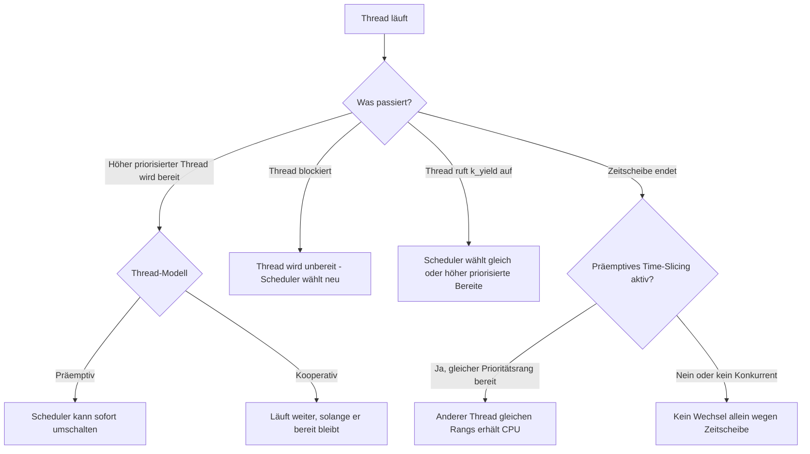
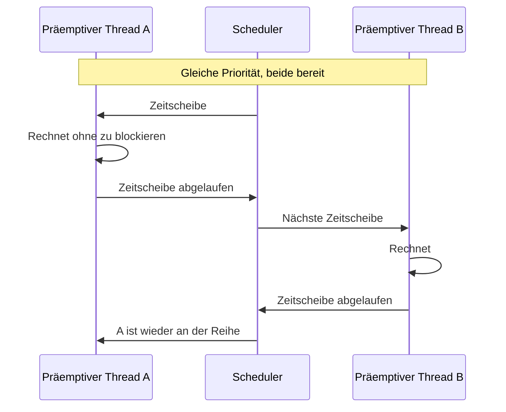

# Exkurs: Scheduling-Modelle

Zephyr verwendet einen **prioritätsbasierten Scheduler**: Er wählt aus den
bereiten Threads den mit der höchsten Priorität aus. Kleinere Zahlen bedeuten
höhere Priorität. Bei gleicher Priorität kommt grundsätzlich der Thread zum Zug,
der am längsten bereit ist. Das Scheduling-Modell eines Threads bestimmt, ob
und wann ein anderer bereiter Thread ihn verdrängen darf.

## Kooperativ und präemptiv

- **Präemptiv** (`K_PRIO_PREEMPT(...)`, Priorität >= 0): Ein neu bereiter Thread
  mit höherer Priorität kann den aktuell laufenden Thread verdrängen. Threads
  gleicher Priorität wechseln ohne aktiviertes Time-Slicing typischerweise erst
  bei Blockierung oder freiwilliger Abgabe.
- **Kooperativ** (`K_PRIO_COOP(...)`, Priorität < 0): Der Thread behält die CPU,
  solange er bereit bleibt – auch dann, wenn ein anderer Thread höher
  priorisiert ist. Er gibt sie durch Blockieren, etwa mit `k_sleep()` oder
  einem wartenden `k_sem_take()`, beziehungsweise mit `k_yield()` ab.
- Beide Arten können jederzeit durch eine ISR unterbrochen werden. Ein
  kooperativer Thread schützt nicht vor Interrupts.

`k_yield()` ist keine allgemeine Übergabe an beliebige niedrigere Prioritäten:
Der aufrufende Thread reiht sich hinter bereite Threads gleicher Priorität ein;
höher priorisierte Threads laufen ebenfalls zuerst. `k_sleep()` macht den
aufrufenden Thread dagegen für die Wartezeit unbereit.

## Was bedeutet Time-Slicing?

`CONFIG_TIMESLICING` kann präemptive Threads **gleicher Priorität** regelmäßig
abwechseln lassen. Die Zeitscheibe wird in System-Ticks gemessen und über
`CONFIG_TIMESLICE_SIZE` konfiguriert. Time-Slicing ist keine Garantie für
exakte Laufzeit oder Fairness über alle Prioritäten: Ein bereiter Thread mit
höherer Priorität kann die anderen weiterhin verdrängen. Kooperative Threads
werden durch diese Zeitscheibe nicht zwangsweise verdrängt.

## Erweiterung: Deadline-Scheduling

Optional kann `CONFIG_SCHED_DEADLINE` bei Threads mit **gleicher statischer
Priorität** die gesetzte Deadline als zusätzliches Auswahlkriterium verwenden:
Die frühere Deadline wird bevorzugt. Es ersetzt weder Prioritäten noch
Präemption und ist kein automatischer Echtzeit- oder Deadline-Nachweis.

## Merksatz

**Priorität bestimmt, wer bevorzugt wird; kooperativ oder präemptiv bestimmt,
ob ein laufender Thread verdrängt werden kann.** Blockieren gibt die CPU immer
frei; Time-Slicing teilt sie optional zwischen präemptiven Threads gleichen
Prioritätsrangs.

Weiterführend: [Scheduling in der Zephyr-Dokumentation](https://docs.zephyrproject.org/latest/kernel/services/scheduling/index.html),
[Zephyr-Threadmodell und Kontextwechsel](thread-modell-und-kontextwechsel.md)
und [Übung 2.06 – Scheduling sichtbar machen](../practices/day2/2.06-scheduling-exercise/README.md).
