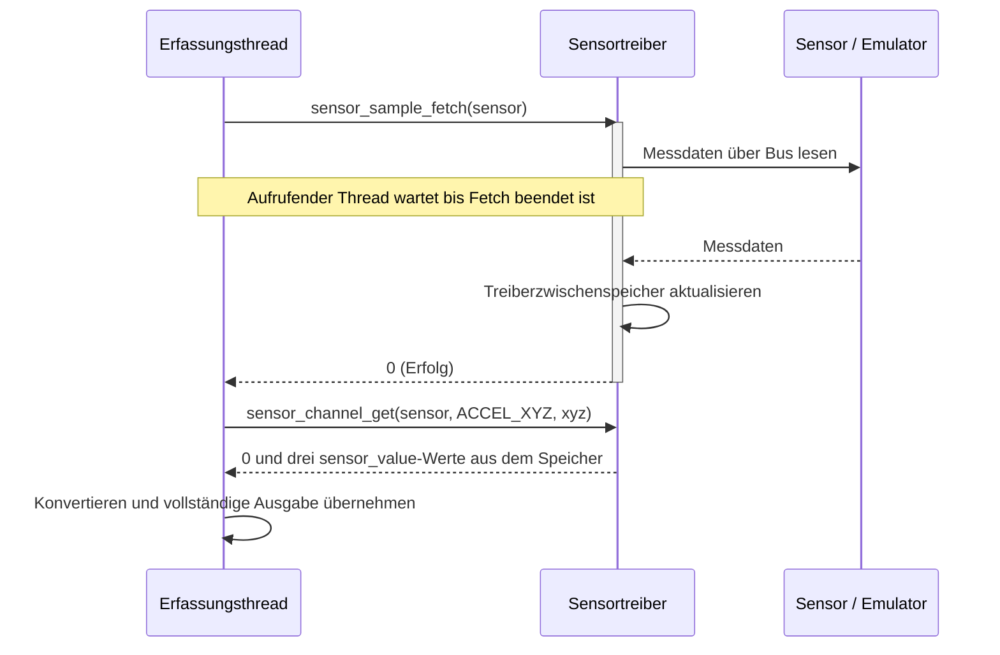
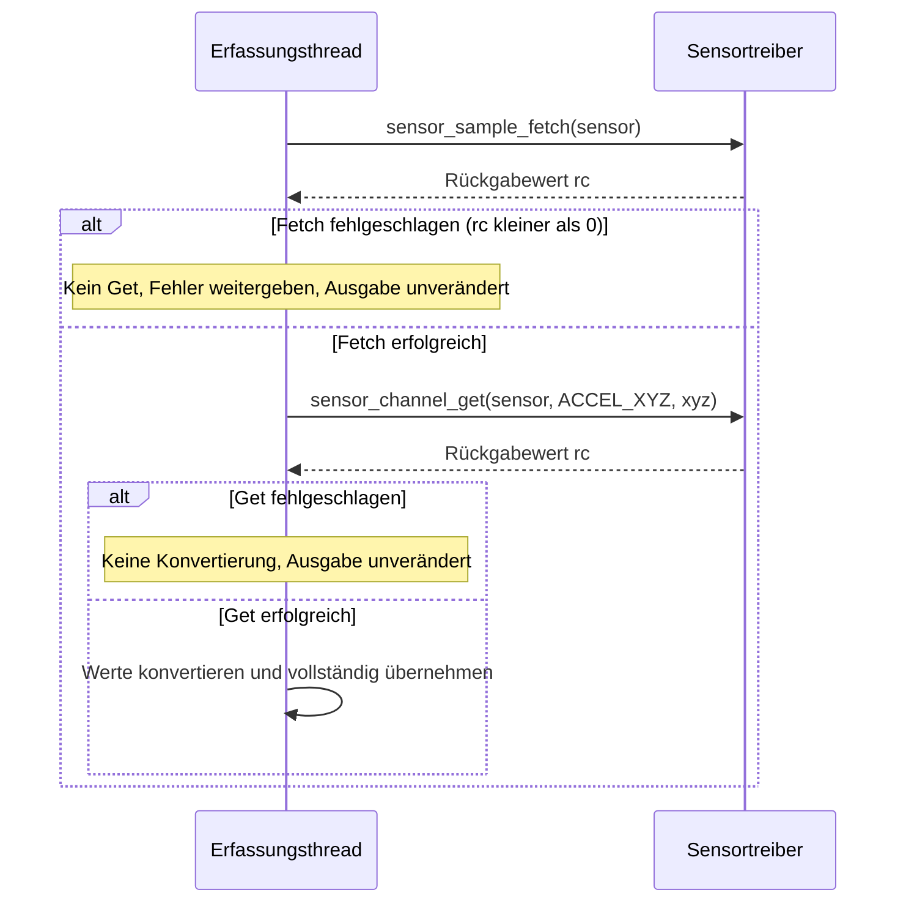

# Exkurs: Zephyr Sensor API

Die Sensor API bietet einen gemeinsamen Zugriff auf Messwerte verschiedener Sensoren.
Der Treiber übernimmt Registerzugriffe und Umrechnung; die Anwendung arbeitet mit
**Channels und physikalischen Einheiten**. Tag 4 nutzt den klassischen Fetch/Get-Pfad.

**Datenweg:** Devicetree-Alias → Gerät → Treiber → Sensor API → fachliche Probe.
Bei realer Hardware kommuniziert der Treiber über I²C/SPI; im Kurs ersetzt der Emulator
das Busgerät. Der Anwendungscode verwendet dieselbe Sensor API.

## Die drei Bausteine

| Baustein | Bedeutung | Beispiel |
|---|---|---|
| **Channel** | Welche Messgröße wird gelesen? | `SENSOR_CHAN_ACCEL_XYZ`: drei Beschleunigungsachsen |
| **Attribute** | Wie wird der Sensor eingestellt? | `sensor_attr_set()`: Messbereich oder Abtastrate |
| **Trigger** | Welches Sensorereignis meldet der Treiber? | `sensor_trigger_set()`: Daten bereit |

Welche Channels, Attribute und Trigger funktionieren, hängt von Sensor und Treiber ab.
Devicetree beschreibt Bus, Adresse und Alias; Kconfig aktiviert Sensor-Subsystem und Treiber.

## Sicherer Ablauf: Ready → Fetch → Get → Convert

`device_is_ready()` prüft die Geräteinitialisierung. **Fetch liest und speichert;
Get übernimmt einen Channel aus dem Treiberzwischenspeicher.** Get allein fordert keine
neue Messung an. Das folgende Diagramm zeigt den erfolgreichen Ablauf für den Bus-Sensor
im Kurs; „Sensor / Emulator“ bezeichnet das reale Gerät oder seinen Softwareersatz.



Im Diagramm steht `ACCEL_XYZ` verkürzt für `SENSOR_CHAN_ACCEL_XYZ`.
Mehrere Get-Aufrufe ohne weiteren Fetch lesen denselben gespeicherten Messstand.
[Dokumentation: Fetch/Get](https://docs.zephyrproject.org/latest/hardware/peripherals/sensor/fetch_and_get.html)

### Fehler unterbrechen die Folge



### Welche Aufrufe blockieren?

| Aufruf | Verhalten und Konsequenz |
|---|---|
| `device_is_ready()` | Prüft den Initialisierungsstatus; startet keine Messung. |
| `sensor_sample_fetch()` / `sensor_sample_fetch_chan()` | Synchron und blockierend bis zum Abschluss; Buszugriff und ggf. sensorabhängige Wartezeit. Im Thread-Kontext aufrufen, nicht aus einer ISR. |
| `sensor_channel_get()` | Liest den zuletzt gefetchten Treiberstand; startet keinen neuen Fetch. Keine allgemeine Garantie für eine feste Laufzeit. |
| `sensor_value_to_milli()` | Lokale Berechnung ohne Buszugriff. |

Blockierend heißt: Der aufrufende Thread läuft erst nach der Rückkehr weiter; andere
bereite Threads können während einer Wartephase laufen. Ein Fetch im gemeinsamen
Workqueue-Thread verzögert dort nachfolgende Work Items. Für längere Erfassung einen
eigenen Thread verwenden; Trigger-Callbacks kurz halten.

Bei mehreren Zugriffskontexten **Fetch und alle zugehörigen Get-Aufrufe gemeinsam**
durch einen Mutex schützen. Auch der Lock kann warten. Alle Nutzer desselben Geräts
müssen diese Regel einhalten, damit kein anderer Fetch den Messstand dazwischen ersetzt.
Das folgende Beispiel setzt einen einzigen Erfassungskontext voraus.

```c
#include <errno.h>
#include <stdint.h>
#include <zephyr/device.h>
#include <zephyr/devicetree.h>
#include <zephyr/drivers/sensor.h>

/* Voraussetzung: aktiver Sensor mit Alias motion-sensor im Overlay. */
static const struct device *const sensor = DEVICE_DT_GET(DT_ALIAS(motion_sensor));

int read_acceleration(int64_t out_mm_s2[3])
{
    struct sensor_value xyz[3];
    if (!device_is_ready(sensor)) { return -ENODEV; }
    int rc = sensor_sample_fetch(sensor);
    if (rc < 0) { return rc; }
    rc = sensor_channel_get(sensor, SENSOR_CHAN_ACCEL_XYZ, xyz);
    if (rc < 0) { return rc; }
    for (int i = 0; i < 3; ++i) {
        out_mm_s2[i] = sensor_value_to_milli(&xyz[i]);
    }
    return 0; /* Ausgabe erst nach vollständig erfolgreichem Lesen ändern. */
}
```

## Werte richtig einordnen

`struct sensor_value` beschreibt **val1 + val2 / 1 000 000**. Beispiel: `val1 = -1`,
`val2 = -500000` bedeutet −1,5. Beschleunigung wird in **m/s²** geliefert;
`sensor_value_to_milli()` ergibt hier **mm/s²**, keine Rohwerte oder g-Werte.
Bei XYZ sind drei `sensor_value`-Elemente erforderlich. Vor einer Verengung auf `int32_t`
den zulässigen Wertebereich prüfen.
[API-Referenz](https://docs.zephyrproject.org/latest/doxygen/html/group__sensor__interface.html)

## Fehler und Anwendungsgrenze

- **Nicht bereit:** Devicetree, Kconfig, Bus und Geräteinitialisierung prüfen.
- **Fetch/Get fehlgeschlagen:** negativen Fehlercode weitergeben; Werte nicht übernehmen.
- **Erfolg:** bedeutet erfolgreicher API-Zugriff. Plausibilität, Alter und Qualitätsstatus
  bewertet anschließend die Anwendung.
- **Emulator:** bekannte Stimuli mit begründeter Toleranz prüfen; Emulatorsteuerung getrennt
  halten. Das prüft den Softwarepfad, nicht elektrische Eigenschaften realer Hardware.

**Merksatz:** Sensorwerte vollständig lesen und Fehler prüfen; erst danach Sequenz,
Zeitstempel und Qualität zur transportneutralen Probe ergänzen.

Kursbezug: [4.03 – Walkthrough](../practices/day4/4.03-sensor-api-walkthrough/README.md)
und [4.04 – Sensorzugriff](../practices/day4/4.04-sensor-read/README.md).
