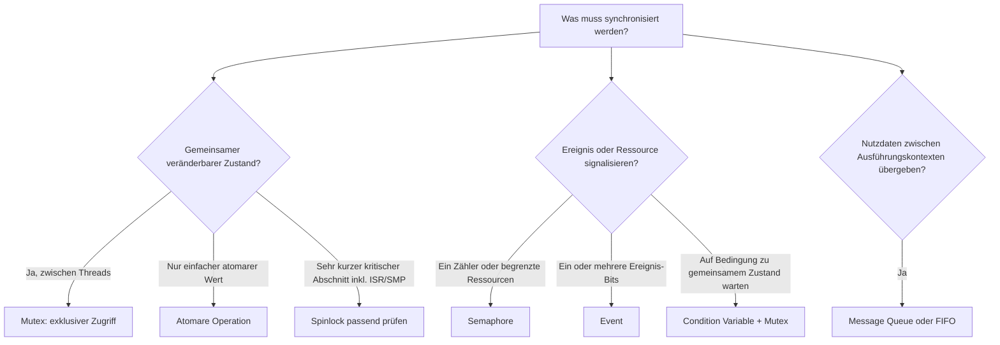
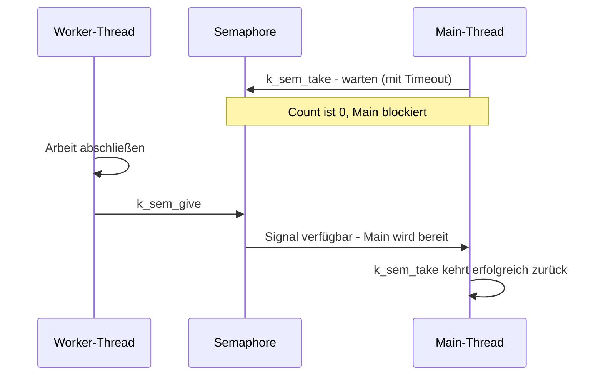

# Exkurs: Synchronisierungsmechanismen

Threads und ISRs arbeiten nebenläufig und können auf gemeinsam genutzte Daten
oder Ereignisse treffen. Synchronisierung verhindert Datenrennen, koordiniert
Ausführung und übergibt Daten. Wähle den Kernelmechanismus nach der Aufgabe:

## Die wichtigsten Mechanismen

| Mechanismus | Zweck | Wichtige Grenze |
|---|---|---|
| **Mutex** (`k_mutex`) | Schützt einen kritischen Abschnitt zwischen Threads; hat einen Besitzer und unterstützt Priority Inheritance. | Nicht in ISRs verwenden. Kurz halten und in jedem Erfolgsweg wieder freigeben. |
| **Semaphore** (`k_sem`) | Zählt Signale oder verfügbare Ressourcen; gut zur Thread-/ISR-Synchronisierung. | Kein Mutex: kein Besitzer und keine Prioritätsvererbung. Ein ISR darf nicht blockierend darauf warten. |
| **Event** (`k_event`) | Signalisiert Ereignisse als Bits; Threads können auf ein oder mehrere Bits warten. | Kein Schutz für gemeinsam veränderte Daten; bei mehreren Wartenden Reset-/Konsumverhalten beachten. |
| **Condition Variable** (`k_condvar`) | Wartet auf eine Bedingung, die durch gemeinsam geschützten Zustand definiert ist. | Mit Mutex verwenden; nach dem Aufwachen die Bedingung erneut unter dem Mutex prüfen. |
| **Atomics** | Führt einzelne unterstützte Lese-/Änderungsoperationen atomar aus. | Macht mehrere zusammenhängende Operationen oder beliebige Datenstrukturen nicht automatisch sicher. |
| **Message Queue** (`k_msgq`) | Übergibt Nachrichten zwischen Kontexten; Queue-Synchronisierung übernimmt der Kernel. | Kapazität, Timeout und Verhalten bei voller Queue bewusst wählen. |

## Beispiel: Ereignissignalisierung per Semaphore

Ein Worker signalisiert mit `k_sem_give()`, dass er fertig ist. Der aufrufende
Thread wartet mit endlichem Timeout. Die Semaphore überträgt hier **kein
Ergebnisobjekt** und schützt auch keinen Zähler – sie signalisiert nur das
Ereignis.

Für einen gemeinsam genutzten Zähler wäre dagegen ein Mutex um den gesamten
Read–Modify–Write-Abschnitt passend. Für Messwerte zwischen Producer und
Consumer ist eine Message Queue meist besser als ein Semaphore plus selbst
verwalteter Puffer.

## Praxisregeln

- Verwende einen **Mutex für Besitz und exklusiven Thread-Zugriff**, eine
  **Semaphore für Zählung/Signalisierung** und eine **Queue für Nutzdaten**.
- Prüfe Rückgabewerte und Timeouts; sie sind Teil des Synchronisierungsvertrags.
- Halte kritische Abschnitte kurz. Blockiere nicht mit einem Mutex in der Hand,
  außer das Protokoll erfordert es ausdrücklich.
- Ein Mutex kann Priority Inversion begrenzen, beseitigt aber nicht automatisch
  lange Sperrzeiten oder Deadlocks. Vermeide unnötig verschachtelte Sperren.
- ISR-Kontext ist eingeschränkt: Verwende dort nur APIs, die für ISRs zulässig
  sind, und niemals eine Operation, die auf einen anderen Thread warten muss.

**Merksatz:** Mutex schützt Zustand, Semaphore signalisiert oder zählt,
Condition Variable wartet auf eine Bedingung und Queue übergibt Daten.

Weiterführend: [Zephyr Synchronization](https://docs.zephyrproject.org/latest/kernel/services/synchronization/index.html),
[Race Condition beheben](../practices/day2/2.09-race-condition-exercise/README.md)
und [Integrierte Mini-Anwendung](../practices/day2/2.13-integrated-application/README.md).
