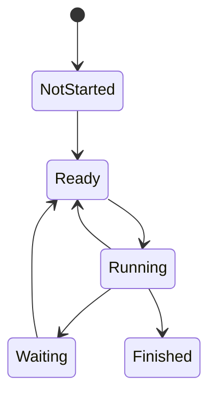
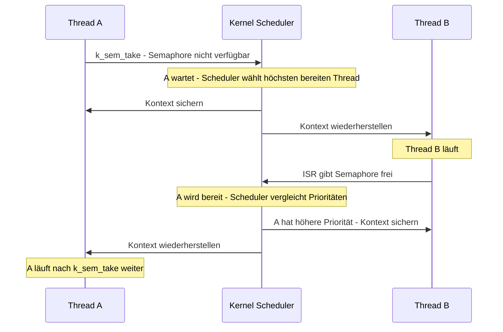

# Zephyr-Threadmodell und Kontextwechsel

Zephyr teilt die CPU-Zeit zwischen Threads. Zu einem Zeitpunkt läuft auf einem
CPU-Kern höchstens ein Thread; Interrupt Service Routines (ISRs) können ihn
unterbrechen. Der Scheduler wählt an definierten **Reschedule-Punkten** den
Thread aus, der als Nächstes laufen soll.

## Zustände und Auswahl

Ein Thread ist **bereit**, wenn nichts seine Ausführung verhindert. Er kann
**laufen**, wenn ihn der Scheduler auf einem Kern ausgewählt hat. Ein Thread
ist nicht bereit, wenn er zum Beispiel auf ein Semaphore, eine Nachricht oder
einen Timeout wartet, noch nicht gestartet, suspendiert oder beendet ist.
„Laufend“ ist damit die momentane Ausführung eines bereiten Threads, kein
zusätzlicher Grund, warum ein Thread nicht bereit wäre.

Der Scheduler wählt den bereiten Thread mit der höchsten Priorität. In Zephyr
gilt: **kleinere Zahl = höhere Priorität**. Bei gleicher Priorität wird
grundsätzlich der Thread bevorzugt, der am längsten bereit ist; konfiguriertes
Zeitslicing kann Threads gleicher Priorität regelmäßig abwechseln lassen.

- **Präemptiver Thread** (nichtnegative Priorität): Ein höher priorisierter
  bereiter Thread kann ihn verdrängen. Ein blockierender Aufruf wie `k_sleep()`
  oder `k_sem_take()` gibt die CPU ebenfalls frei.
- **Kooperativer Thread** (negative Priorität): Er behält die CPU, solange er
  bereit bleibt. Er gibt sie etwa durch Blockieren oder `k_yield()` ab. Auch
  ISRs können einen Thread unterbrechen; Kooperativität verhindert keine
  Interrupts.

## Was passiert beim Kontextwechsel?

Ein Kontextwechsel ist der Wechsel von der Ausführung eines Threads zu einem
anderen. Der Kernel sichert den architekturspezifisch erforderlichen
Ausführungskontext des bisherigen Threads und stellt den des ausgewählten
Threads wieder her. Dazu gehören die relevanten CPU-Register und der
Stack-Kontext; der Thread Control Block (`struct k_thread`) hält
Kernel-Metadaten. Details und Registerumfang hängen von Architektur und
Konfiguration ab. Der unterbrochene Thread kann später an seiner
Unterbrechungsstelle weiterlaufen.

Ein Wechsel kann beispielsweise entstehen, wenn ein Thread blockiert,
`k_yield()` aufruft, ein höher priorisierter Thread bereit wird oder eine ISR
beim Rückweg in den Thread-Kontext eine neue Scheduler-Entscheidung auslöst.

Die ISR selbst ist **kein Thread** und wird nicht wie ein Thread eingeplant.
Ob nach der ISR der bisherige Thread oder ein anderer Thread weiterläuft,
entscheidet der Scheduler am Rückweg. Ein Kontextwechsel verursacht Aufwand:
Register sichern/wiederherstellen und Scheduler-Arbeit verbrauchen CPU-Zeit.
Häufige Wechsel sowie zu kleine Thread-Stacks können deshalb Leistung und
Zuverlässigkeit beeinträchtigen.

## Merksatz

**Der Scheduler entscheidet, wer läuft; der Kontextwechsel macht den Wechsel
technisch möglich.** Blockieren gibt die CPU ab, Präemption reagiert auf
höhere Priorität, und eine ISR kann eine neue Entscheidung auslösen.

Weiterführend: [Scheduling in der Zephyr-Dokumentation](https://docs.zephyrproject.org/latest/kernel/services/scheduling/index.html),
[Threads](https://docs.zephyrproject.org/latest/kernel/services/threads/index.html) und
[Workshop-Folien 2.02 – Ausführungsmodell des Kernels](../slides/day2/Zephyr%20RTOS%20-%202.02%20Ausführungsmodell%20des%20Kernels.pdf).
