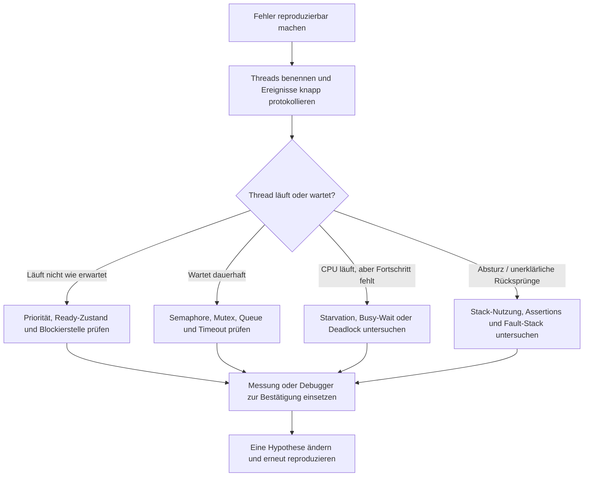
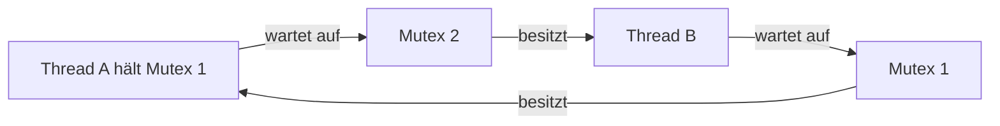

# Exkurs: Zephyr-Threading debuggen

Threading-Fehler zeigen sich oft nicht als eindeutiger Absturz: Ein Thread
läuft nie, wartet dauerhaft, verhungert, greift gleichzeitig auf Daten zu oder
läuft in einen Stack-Overflow. Debugge deshalb zuerst den **Threadzustand und
die Synchronisierung**, statt nur Verzögerungen einzubauen.

## Systematisch eingrenzen

## Nützliche Werkzeuge und Hinweise

- **Thread Analyzer:** `CONFIG_THREAD_ANALYZER=y` aktiviert die Analyse;
  `CONFIG_THREAD_ANALYZER_USE_PRINTK=y` gibt sie über `printk` aus.
  `thread_analyzer_print()` beziehungsweise `thread_analyzer_run()` liefern
  Thread- und Stack-Informationen; CPU-Laufzeitstatistik kann ebenfalls
  ausgewiesen werden. Der Analyzer braucht selbst Stack und Laufzeit – seine
  Messung ist daher nicht völlig ohne Einfluss.
- **Threadnamen und Zustände:** Vergib aussagekräftige Namen (bei dynamischen
  Threads etwa mit `k_thread_name_set()`). Nutze `k_thread_foreach()` und
  `k_thread_state_str()` für eine eigene Momentaufnahme, sofern die
  entsprechende API/Konfiguration im verwendeten Zephyr-Stand verfügbar ist.
- **Stack-Probleme:** Aktiviere passende Stack-Schutz-/Analyseoptionen für
  Target und Build-Konfiguration. Thread Analyzer zeigt die beobachtete
  Stack-Nutzung; eine Laufzeitmessung ist kein Beweis für den maximalen
  Bedarf. Beachte ISR- und Interrupt-Stack separat, falls die Plattform sie
  getrennt führt.
- **Debugger:** Mit einem unterstützten Target und Debug-Probe in GDB
  anhalten, Backtraces aller Threads ansehen und prüfen, wo Threads warten
  oder in Schleifen stehen. Das Verhalten von `native_sim` oder Host-GDB
  ersetzt keine Messung auf der Zielhardware.
- **Protokollierung:** Logge Threadname, Ereignis und relevante Werte; vermeide
  umfangreiche `printk`-Ausgaben in zeitkritischen Pfaden. Ausgabe kann
  Scheduling und Laufzeiten verändern.

## Deadlock als Wartezyklus erkennen

Ein Deadlock entsteht, wenn Threads Ressourcen zyklisch halten und aufeinander
warten. Ein Wartegraph macht die Abhängigkeit sichtbar:

Der Zyklus weist auf eine mögliche Deadlock-Ursache hin. Prüfe den tatsächlichen
Sperrablauf und Rückgabewerte; ein Timeout kann den Stillstand sichtbar machen,
ersetzt aber keine konsistente Sperrreihenfolge. Weitere typische Ursachen:
Semaphore nie gegeben, Queue dauerhaft voll/leer, unerwartet lange
Blockierzeit oder ein Thread mit zu niedriger Priorität.

## Merksatz

**Erst beobachten, dann erklären:** Namen und Zustände sichtbar machen,
Wartebeziehungen und Laufzeit/Stack messen, eine Hypothese testen. Zusätzliche
Logs, Analyzer und Debugger können das Timing beeinflussen – bestätige
zeitkritische Befunde deshalb auch mit möglichst geringer Instrumentierung.

Weiterführend: [Zephyr Thread Analyzer](https://docs.zephyrproject.org/latest/services/debugging/thread-analyzer.html),
[Threadzustände](thread-modell-und-kontextwechsel.md),
[Scheduling-Modelle](zephyr-scheduling-modelle.md) und
[Synchronisierungsmechanismen](zephyr-synchronisierung.md).
