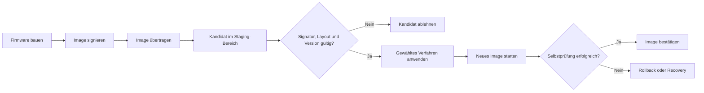
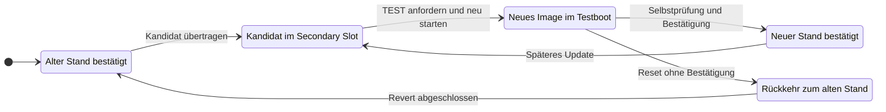
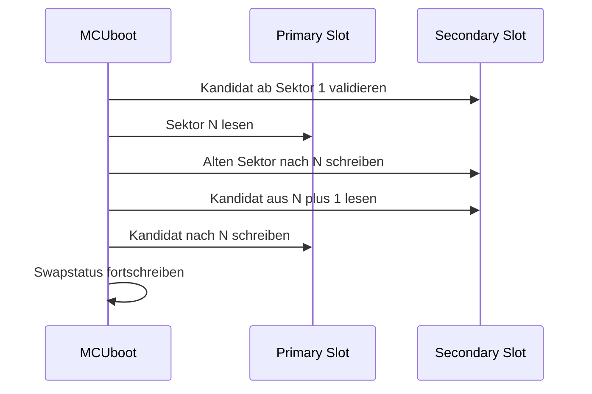
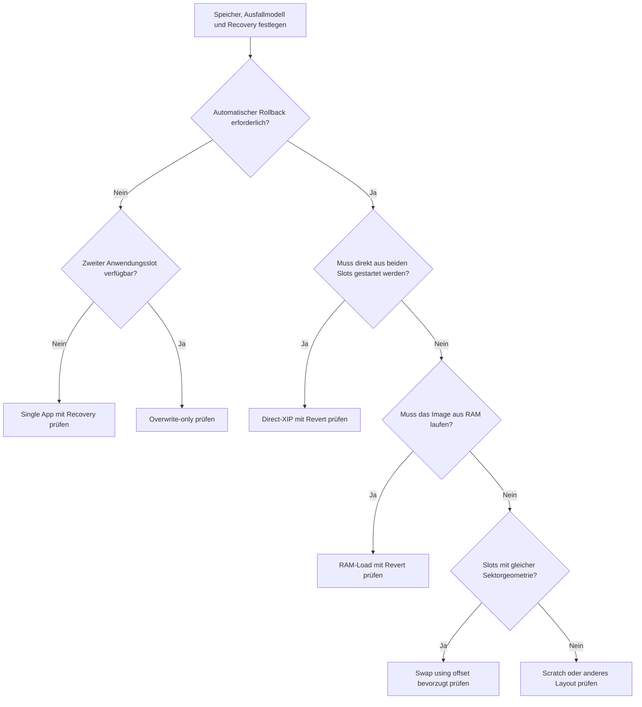

# Exkurs: Firmware-Updateverfahren mit Zephyr und MCUboot

Ein Firmware-Update besteht nicht nur aus dem Herunterladen einer neuen Binärdatei.
Für ein robustes Produkt müssen Transport, Prüfung, Installation, Bootentscheidung,
Bestätigung und gegebenenfalls Rollback als getrennte Schritte betrachtet werden.
MCUboot übernimmt vor allem die Prüfung und Bootauswahl; wie ein Image auf das Gerät
gelangt, ist davon unabhängig.

## Vier getrennte Fragen

| Ebene | Leitfrage | Beispiele |
|---|---|---|
| Transport | Wie gelangt das Image auf das Gerät? | MCUmgr/SMP über BLE, UART oder UDP; USB-DFU; HTTPS; externe Speicherkarte |
| Authentisierung | Darf dieses Image ausgeführt werden? | Signatur, vertrauenswürdiger Schlüssel, Hash, Security Counter |
| Installation | Wie wird der Kandidat ausführbar? | Swap, Overwrite, Direct-XIP, Kopieren nach RAM |
| Freigabe | Bleibt das neue Image dauerhaft aktiv? | Testboot, Selbstprüfung, Bestätigung oder Revert |

Ein Wechsel des Transportwegs ändert daher nicht automatisch das Installationsverfahren.
Beispielsweise können sowohl BLE als auch UART dasselbe signierte Image in den Secondary
Slot eines Swap-Layouts übertragen.



## Gemeinsame MCUboot-Grundbegriffe

### Primary und Secondary Slot

Bei klassischen Zwei-Slot-Verfahren enthält der Primary Slot das regulär startbare
Image. Der Secondary Slot nimmt den neuen Kandidaten auf. Swap- und
Overwrite-Verfahren bringen den Kandidaten vor der Ausführung in den Primary Slot.
Direct-XIP und RAM-Load behandeln beide Slots dagegen als mögliche Quellen eines
ausführbaren Images.

Die Bezeichnungen beschreiben die Rolle im Bootablauf und nicht zwingend zwei physisch
getrennte Flashbausteine. Beide Slots können im internen Flash liegen oder – abhängig
von Plattform und Verfahren – unterschiedliche Speicher verwenden.

### Imageheader, TLVs und Trailer

Ein signiertes MCUboot-Image besteht vereinfacht aus:

```text
+----------------------+--------------------------------+----------------------+
| MCUboot-Imageheader  | Anwendungscode und Nutzdaten  | geschützte TLVs      |
+----------------------+--------------------------------+----------------------+
                                                        Signatur, Hash, Counter
```

Am Ende eines Slots kann zusätzlich der Image-Trailer liegen. Er speichert unter
anderem Zustandsinformationen für Swap, Testboot und Bestätigung. Header und TLVs
beschreiben das Image; der Trailer beschreibt den aktuellen Updatezustand des Slots.

### Test, Permanent und Revert

Ein Testupdate erlaubt dem neuen Image genau den kontrollierten Übergang in den
dauerhaften Zustand. Die Anwendung bestätigt sich erst, nachdem die für das Produkt
relevanten Selbstprüfungen abgeschlossen sind.



Ein permanentes Update überspringt diese Rückfallentscheidung. Das kann für vollständig
vorab geprüfte Systeme sinnvoll sein, nimmt dem Gerät aber die Möglichkeit, nach einem
fehlgeschlagenen Erststart automatisch auf den vorherigen Stand zurückzukehren.

## Swap using offset

Swap using offset ist in aktuellen Zephyr-Sysbuild-Konfigurationen der bevorzugte
Standard, sofern die Plattform keinen abweichenden Modus vorgibt. Das Updateimage
beginnt im Secondary Slot erst ab dem zweiten Sektor. Dieser freie Sektor ermöglicht
das schrittweise Tauschen ohne separate Scratch-Partition.

Vereinfachter Ablauf für Sektor `N`:



Wichtige Eigenschaften:

- Der Secondary Slot benötigt einen zusätzlichen Sektor oder lässt entsprechend weniger
  Platz für das Updateimage.
- Beide Slots müssen dieselbe Sektorgeometrie verwenden.
- Pro Sektorschritt werden weniger Statusflags als bei Swap using move benötigt.
- Ein vollständiger Swap verursacht laut MCUboot-Design je einen Löschzyklus auf
  Primary und Secondary.
- Test, Bestätigung und Revert sind möglich.

Die zugehörige Sysbuild-Auswahl lautet:

```conf
SB_CONFIG_MCUBOOT_MODE_SWAP_USING_OFFSET=y
```

## Swap using move

Swap using move benötigt keine Scratch-Partition. Stattdessen besitzt der Primary Slot
einen zusätzlichen Sektor. Zunächst wird das alte Primary-Image um einen Sektor nach
oben verschoben; anschließend werden Primary und Secondary sektorweise getauscht.

Gegenüber Swap using offset benötigt das Verfahren mehr Schreib- und Löschoperationen
im Primary Slot. Es bleibt vor allem für bestehende Produkte relevant, deren Layout und
Updatepfad bereits darauf ausgelegt sind. Für neue Designs wird Swap using offset
bevorzugt.

```conf
SB_CONFIG_MCUBOOT_MODE_SWAP_USING_MOVE=y
```

## Swap using scratch

Dieses konservative Verfahren verwendet neben Primary und Secondary eine eigene
Scratch-Partition als temporären Speicher. Sie muss mindestens so groß wie der größte
zu tauschende Flashsektor sein.

Der Ansatz kann auch mit heterogenen Sektorgrößen umgehen. Gleichzeitig benötigt er
zusätzlichen Flash und belastet die Scratch-Sektoren wiederholt. Ein größerer
Scratch-Bereich verteilt den Verschleiß, reduziert aber den für andere Daten verfügbaren
Speicher. MCUboot weist darauf hin, dass dieses Verfahren künftig entfernt werden kann;
für neue Designs sollte es deshalb nur mit konkreter Begründung gewählt werden.

```conf
SB_CONFIG_MCUBOOT_MODE_SWAP_SCRATCH=y
```

## Overwrite-only

Bei Overwrite-only wird der gültige Kandidat aus dem Secondary Slot über den Primary
Slot kopiert. Das alte Image wird dabei nicht im Secondary Slot erhalten.

Das Verfahren ist einfacher als ein Swap und benötigt keinen späteren Rücktausch. Nach
dem Überschreiben fehlt jedoch die vorherige Firmware für einen automatischen Revert.
Ein Produkt braucht deshalb einen unabhängigen Recovery-Pfad oder muss akzeptieren,
dass ein zwar korrekt signiertes, aber funktional fehlerhaftes Image nicht automatisch
zurückgenommen werden kann.

```conf
SB_CONFIG_MCUBOOT_MODE_OVERWRITE_ONLY=y
```

## Direct-XIP

Direct-XIP führt das ausgewählte Image direkt aus seinem jeweiligen Slot aus. MCUboot
muss die Images nicht in den Primary Slot kopieren. Stattdessen prüft es die Kandidaten
und wählt abhängig vom konfigurierten Direct-XIP-Modus und den Imagezuständen den
passenden Slot.

Daraus folgen besondere Anforderungen:

- Images müssen für die jeweilige Slotadresse gelinkt sein.
- Der Downloadclient muss wissen, welcher Slot aktiv ist und welcher beschrieben werden
  darf.
- Zephyr Sysbuild kann eine Variante für den zweiten Slot erzeugen.
- Der Bootvorgang benötigt keinen vollständigen Flash-Swap.
- MCUboots On-the-fly-Imageverschlüsselung beim Swap ist hier nicht verfügbar.
- Rollback erfordert ausdrücklich den Direct-XIP-with-revert-Modus und passende Trailer.

```conf
SB_CONFIG_MCUBOOT_MODE_DIRECT_XIP_WITH_REVERT=y
SB_CONFIG_MCUBOOT_DIRECT_XIP_GENERATE_VARIANT=y
```

Ohne Revert-Variante wird typischerweise das neueste gültige Image gewählt und ein
Downgrade verhindert. Mit Revert wird ein nicht bestätigter Kandidat beim nächsten Boot
verworfen und das zuvor bestätigte Image wieder ausgewählt.

## RAM-Load

RAM-Load wählt ein gültiges Image aus einem Slot, kopiert es an die im Imageheader
hinterlegte RAM-Adresse und führt es dort aus. Das Image muss für diese Adresse gelinkt
und beim Signieren mit der Load-Adresse versehen werden.

```sh
imgtool.py sign --load-addr <ram-adresse> ...
```

Das Verfahren eignet sich unter anderem für Systeme, deren Images in externem Speicher
liegen, während die Ausführung aus internem RAM erfolgen soll. Dem stehen zusätzlicher
RAM-Bedarf und die Kopierzeit bei jedem Boot gegenüber. Eine Revert-Variante ist
verfügbar, benötigt aber wie Direct-XIP passende Trailer und Bestätigungslogik.

```conf
SB_CONFIG_MCUBOOT_MODE_RAM_LOAD_WITH_REVERT=y
```

## Firmware-Updater und Single-Slot-Recovery

Im Firmware-Updater-Modus enthält der primäre Slot die Hauptanwendung. Der zweite Slot
enthält keine zweite Version derselben Anwendung, sondern ein dediziertes, selbst
signiertes Updater-Programm. MCUboot startet dieses Programm nur über einen definierten
Einstiegsmechanismus oder wenn die Hauptanwendung nicht startfähig ist. Der Updater
ersetzt anschließend die Hauptanwendung.

```conf
SB_CONFIG_MCUBOOT_MODE_FIRMWARE_UPDATER=y
```

Beim reinen Single-App-Modus existiert nur ein Anwendungsslot. Updates müssen über einen
vom Bootloader bereitgestellten Recovery-Kanal eingespielt werden, beispielsweise über
MCUboot Serial Recovery. Dieser Aufbau spart Flash, bietet aber ohne weitere
produktspezifische Maßnahmen weder einen parallelen Kandidaten noch A/B-Rollback.

## Vergleich der Verfahren

| Verfahren | Speicherlayout | Vorteile | Nachteile | Automatischer Rollback |
|---|---|---|---|---|
| Swap using offset | Primary und größerer Secondary mit zusätzlichem Anfangssektor | Kein Scratch; weniger Statusdaten und Flashverschleiß als move; Test und Revert | Gleiche Sektorgeometrie erforderlich; Kandidat beginnt versetzt; zwei vollständige Slots | Ja |
| Swap using move | Größerer Primary mit zusätzlichem Sektor und Secondary | Kein Scratch; bewährter Migrationspfad für bestehende Produkte | Mehr Operationen und Verschleiß im Primary; gleiche Sektorgeometrie; für Neudesigns nicht bevorzugt | Ja |
| Swap using scratch | Primary, Secondary und Scratch | Konservativer Ablauf; unterstützt heterogene Sektorgrößen | Zusätzliche Partition; Scratch-Verschleiß; Kapazitätsplanung; mögliche künftige Entfernung | Ja |
| Overwrite-only | Primary und Secondary | Einfacher Installationspfad; kein Rücktausch erforderlich | Altes Image wird überschrieben; funktional fehlerhaftes Update braucht separaten Recovery-Pfad | Nein |
| Direct-XIP | Zwei gleichwertige ausführbare Slots | Kein Image-Swap; schneller Wechsel; kleinerer Bootloaderpfad | Zwei adressabhängige Imagevarianten; slotbewusster Downloader; Einschränkungen bei Imageverschlüsselung | Optional mit Revert-Modus |
| RAM-Load | Images im Flash oder externen Speicher plus Ausführungsbereich im RAM | Ausführung aus schnellem oder geschützterem internem RAM; externer Imagespeicher möglich | Hoher RAM-Bedarf; Kopierzeit bei jedem Boot; besondere Link- und Signierparameter | Optional mit Revert-Modus |
| Firmware-Updater | Hauptanwendung plus dediziertes Updater-Image | Updatecode von Hauptanwendung getrennt; eigener Recovery-Einstieg | Kein paralleles altes Anwendungsimage; Updater und Schreibvorgang werden sicherheitskritisch | Produktspezifisch |
| Single App mit Recovery | Ein Anwendungsslot plus Bootloader | Geringster Flashbedarf; einfacher Speicherplan | Kein Staging und kein A/B-Stand; Update erfordert Recovery-Modus | Nein |

## Auswahlhilfe



Das Diagramm ist eine Vorauswahl, keine automatische Architekturentscheidung. Zusätzlich
müssen Bootzeit, maximaler Imageumfang, Flashverschleiß, externe Speicher, Schutz vor
Stromausfall und die Recovery-Möglichkeiten des konkreten SoC bewertet werden.

## Sicherheits- und Robustheitsregeln

### Signatur und Verschlüsselung trennen

Eine Signatur schützt Authentizität und Integrität. Sie verbirgt den Imageinhalt nicht.
Transportverschlüsselung schützt das Image während der Übertragung; Imageverschlüsselung
kann zusätzlich den gespeicherten Kandidaten schützen. Diese Mechanismen beantworten
unterschiedliche Bedrohungen.

### Anti-Rollback planen

Eine gültige Signatur sagt nicht, ob die Firmware aktuell genug ist. Ein monotoner
Security Counter oder eine vergleichbare Hardware-gestützte Richtlinie verhindert, dass
ein korrekt signiertes, aber verwundbares altes Image erneut installiert wird. Die
sichtbare Produktversion und der Security Counter sollten getrennt behandelt werden.

### Bestätigung spät genug ausführen

Ein Testimage sollte sich erst bestätigen, wenn mindestens folgende produktspezifische
Punkte geprüft wurden:

- benötigte Geräte und Speicher sind initialisiert,
- persistente Daten konnten gelesen oder migriert werden,
- zentrale Kommunikations- und Watchdogpfade funktionieren,
- die Anwendung erreicht einen dauerhaft nutzbaren Zustand.

Eine Bestätigung direkt am Anfang von `main()` entwertet den automatischen Revert für
viele reale Fehlerbilder.

### Stromausfall systematisch betrachten

Für jeden schreibenden Schritt muss bekannt sein:

- welche Daten bereits dauerhaft geschrieben wurden,
- wie der Vorgang nach Reset fortgesetzt oder verworfen wird,
- welcher Slot noch ein startfähiges Image enthält,
- ob Trailer und Nutzdaten zum selben Zustand gehören.

Die Aussage „MCUboot ist ausfallsicher“ ersetzt nicht die Prüfung des konkreten
Flashlayouts, Treibers, Updateclients und der gewählten Konfiguration.

### Persistente Daten kompatibel halten

Ein Firmware-Rollback stellt nicht automatisch ältere Dateiformate, Einstellungen oder
Datenbankstrukturen wieder her. Neue Firmware sollte Migrationen atomar ausführen oder
Formate verwenden, die auch vom vorherigen Image verstanden werden. Andernfalls kann
der Code erfolgreich zurückrollen, während die Daten inkompatibel bleiben.

## Konfiguration im Build prüfen

Bei einem Sysbuild-Projekt kann die ausgewählte Betriebsart in der erzeugten
Konfiguration geprüft werden:

```sh
grep -E 'SB_CONFIG_MCUBOOT_MODE_' build/zephyr/.config build/_sysbuild/.config 2>/dev/null
grep -E 'CONFIG_BOOT_(SWAP|UPGRADE|DIRECT_XIP|RAM_LOAD|FIRMWARE_LOADER)' \
  build/mcuboot/zephyr/.config
```

Die exakten Buildpfade hängen vom Projekt und der Zephyr-Version ab. Entscheidend ist,
sowohl die Sysbuild-Auswahl als auch die tatsächlich erzeugte MCUboot-Konfiguration zu
prüfen.

## Bezug zu den Übungen

- [5.06 – Zephyr-Image signieren und prüfen](../practices/day5/5.06-sign-image/README.md)
  behandelt Header, TLVs, Signatur und Manipulationsnachweis.
- [5.10 – Update, Bestätigung und Revert](../practices/day5/5.10-update-state-analysis/README.md)
  untersucht vorbereitete Slot- und Trailerzustände.

Der Exkurs ergänzt diese Übungen um die Architekturentscheidung zwischen den
Installationsverfahren. Die simulierten Zustände von `native_sim` ersetzen keine
Stromausfall-, Flashverschleiß- oder Bootzeitmessung auf dem Zielsystem.

## Weiterführende Primärquellen

- [MCUboot Design](https://docs.mcuboot.com/design.html)
- [MCUboot imgtool](https://docs.mcuboot.com/imgtool.html)
- [MCUboot mit Zephyr](https://docs.mcuboot.com/readme-zephyr.html)
- [Zephyr Device Firmware Upgrade](https://docs.zephyrproject.org/latest/services/device_mgmt/dfu.html)
